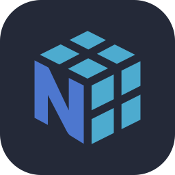
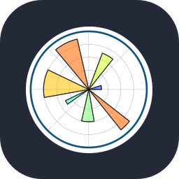

# Hi there, I'm Göktuğ 👋

---

### 🚀 About Me

Computer Engineering graduate (BSc) currently working as an **Artificial Intelligence Intern at FOREO**, building LLM-based workflows with Qwen (Ollama) and Claude. Previously an **Erasmus+ Research Intern in NLP & Machine Learning at ScaDS.AI Dresden/Leipzig**, working on knowledge graphs. Strong foundation in backend (**Java/Spring Boot**) and frontend (**React/React Native**) development, with hands-on enterprise software experience.

---

### ⚙️ Technical Skills

#### 👨‍💻 Languages

  
  
  
  
  
  
  

#### 🤖 AI/ML & LLMs

  
  
  
  
  
  

#### 📚 Frameworks & Libraries

  
  
  
  
  

#### 🛠️ Tools & Platforms

  
  
  
  
  
  
  
  
  

---

### 🌐 Socials

  
  
  

